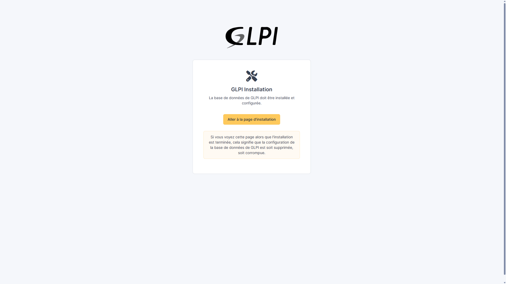
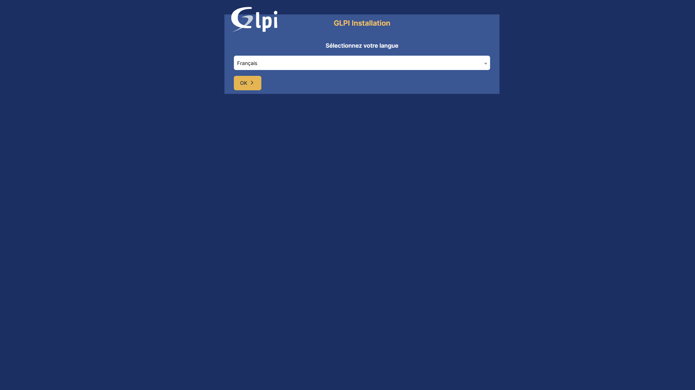

# Installation de GLPI sur Ubuntu 24.04

> Dernière vérification : [Juin 2026]. Certains guides et scripts sont en cours de remise à jour pour les dernières
> versions (OS, paquets, application) — vérifiez la compatibilité avant un usage en production.

Script et guide pour déployer GLPi (Gestionnaire Libre de Parc Informatique), une solution open source de gestion des
services informatiques (ITSM) ; suivi des équipements, gestion des demandes utilisateurs, inventaire matériel/logiciel
et gestion des contrats.

## Sommaire

- [Environnement Cible](#environnement-cible)
- [Prérequis](#prérequis)
- [Installation rapide (script automatisé)](#installation-rapide-script-automatisé)
- [Installation manuelle](#installation-manuelle)
- [Finalisation via l'interface web](#environnement-cible)
- [Bonnes pratiques post-installation](#finalisation-via-linterface-web)
- [Résolution des problèmes courants](#résolution-des-problèmes-courants)
- [Mise à jour](#mise-à-jour)

## Environnement cible

| Composant       | Version                                      |
| --------------- | -------------------------------------------- |
| OS              | Ubuntu Server/Desktop 24.04 LTS ou 26.04 LTS |
| Serveur Web     | Apache2 (SSL recommandé)                     |
| Base de données | MariaDB 10.6+                                |
| PHP             | 8.1 à 8.3 (Ubuntu 24.04) 8.5 (Ubuntu 26.04)  |

Architecture des fichiers (installation avec sécurisation) :

| Dossier         | Utilité                                               |
| --------------- | ----------------------------------------------------- |
| `/var/www/glpi` | Fichiers d'application GLPI                           |
| `/etc/glpi`     | Fichiers de configuration (si sécurisation appliquée) |
| `/var/lib/glpi` | Données d'application (si sécurisation appliquée)     |
| `/var/log/glpi` | Logs spécifiques à GLPI (si sécurisation appliquée)   |

## Prérequis

- Accès root ou sudo
- Minimum 4 Go de RAM (8 Go recommandés en production)
- 20 Go d'espace disque disponible
- Connexion internet active
- Adresse IP statique recommandée
- Nom de domaine local ou public (facultatif)

> Si vous réinstallez GLPI sur un serveur existant, une installation propre d'Ubuntu est recommandée.

## Installation rapide (script automatisé)

Le script [`install_glpi.sh`](./install_glpi.sh) propose deux niveaux d'installation. Il attend trois variables
d'environnement (aucun mot de passe en dur dans le script) :

```bash
export GLPI_DB_NAME="glpi_db"
export GLPI_DB_USER="glpi_user"
export GLPI_DB_PASS="votre_mot_de_passe_fort" #A modifier
export GLPI_DOMAIN="glpi.local"

sudo -E ./install_glpi.sh --auto     # installation fonctionnelle (étapes 1-5)
sudo -E ./install_glpi.sh --auto-prod # installation + sécurisation (étapes 1-7)
# ou
sudo -E ./install_glpi.sh            # menu interactif (étape par étape)
```

Le menu interactif permet de rejouer une étape précise (mise à jour système, MariaDB, base de données, Apache, PHP, mise
à jour de GLPI...) sans relancer toute l'installation.

## Installation fonctionnelle

Suffisante pour un usage local ou de test : GLPI est utilisable dès la fin de ces étapes.

### 1. Préparation de l'environnement

```bash
sudo apt update && sudo apt upgrade -y
```

### 2. Installation des dépendances

```bash
sudo apt install -y apache2 mariadb-server php curl
```

On installe les modules php requis pour l'utilisation optimale de GLPI.

```bash
sudo apt install php-{xml,curl,gd,intl,mysql,bcmath,mbstring,bz2,zip,ldap}
```

> Pour une version PHP spécifique (ex. 8.3), remplacez `php` par `php8.3` et adaptez les noms de modules. Avec Nginx,
> installez `php-fpm` à la place de `libapache2-mod-php`.

### 3. Téléchargement et installation de GLPI

1. Création du répertoire d'installation

```bash
sudo mkdir /var/www/glpi
```

2. Téléchargement de la dernière version disponible de GLPI

```bash
latest=$(curl -s https://api.github.com/repos/glpi-project/glpi/releases/latest | grep tag_name | cut -d '"' -f4)
wget https://github.com/glpi-project/glpi/releases/download/$latest/glpi-$latest.tgz
```

3. Extraction et déploiement des fichiers

```bash
sudo tar -xzf glpi-*.tgz
sudo mv glpi /var/www/
```

4. Attribution des permissions

```bash
sudo chown -R www-data:www-data /var/www/glpi
```

> Les permissions par défaut issues de l'extraction de l'archive sont généralement suffisantes pour que `www-data`
> puisse lire les fichiers — un `chmod` explicite n'est pas toujours nécessaire, mais vérifiez avec
> `ls -la /var/www/glpi` si vous rencontrez une erreur d'accès.

### 4. Configuration de la base de données

Exécutez le script de sécurisation pour configurer correctement MariaDB :

```bash
sudo mariadb-secure-installation
```

Ce script interactif vous guidera pour :

- Définir un mot de passe pour l'utilisateur root (si nécessaire)
- Supprimer les accès anonymes
- Désactiver la connexion root à distance
- Supprimer la base de données test
- Recharger les privilèges

Répondez 'Y' (Yes) à chaque question pour maximiser la sécurité.

Connectez-vous ensuite à MariaDB en tant qu'administrateur pour créer la base de données et l'utilisateur GLPI :

```bash
sudo mysql -u root -p
```

```sql
CREATE DATABASE glpi_db CHARACTER SET utf8mb4 COLLATE utf8mb4_unicode_ci;
CREATE USER 'glpi_user'@'localhost' IDENTIFIED BY '972130';
GRANT ALL PRIVILEGES ON glpi_db.* TO 'glpi_user'@'localhost';
FLUSH PRIVILEGES;
EXIT;
```

> Remplacez 'mot_de_passe_fort par un mot de passe robuste et unique. Notez-le, vous en aurez besoin lors de la
> configuration via l'interface web.

### 5. Configuration du serveur web

Glpi utilise un système de routage qui nécessite l'activation du module `rewrite` d'Apache.

1. Création du fichier de configuration VirtualHost

```bash
sudo nano /etc/apache2/sites-available/glpi.conf
```

```apache
<VirtualHost *:80>
    ServerName glpi.local
    DocumentRoot /var/www/glpi/public

    <Directory /var/www/glpi/public>
        Require all granted
        AllowOverride All
        Options FollowSymLinks
        RewriteEngine On
        RewriteCond %{REQUEST_FILENAME} !-f
        RewriteRule ^(.*)$ index.php [QSA,L]
    </Directory>
</VirtualHost>
```

```bash
sudo a2enmod rewrite
sudo a2ensite glpi.conf
sudo a2dissite 000-default.conf
sudo systemctl reload apache2
```

A ce stade, GLPI est fonctionnel - passez directement à la
[finalisation via l'interface web](#finalisation-via-linterface-web), ou continuez ci-dessous pour un usage en
production.

## Sécurisation recommandée (production) - étapes 6-7

> Ces étapes ne sont **pas requises** pour que GLPI fonctionne. Elles isolent les fichiers sensibles du 'DocumentRoot'
> public (au cas où la configuration Apache serait mal faite un jour) et protègent les cookies de session contre le vol
> via Javascript (XSS). Recommandées avant toute mise en production.

## 6. Isolation des fichiers sensibles

```bash
sudo mkdir -p /etc/glpi /var/lib/glpi /var/log/glpi
sudo cp -r /var/www/glpi/config /etc/glpi
sudo cp -r /var/www/glpi/files/* /var/lib/glpi

sudo chown -R www-data:www-data /var/www/glpi /etc/glpi /var/lib/glpi /var/log/glpi
sudo chmod -R 750 /etc/glpi /var/lib/glpi /var/log/glpi
```

Redirection des chemins personnalisés :

```bash
sudo tee /var/www/glpi/inc/downstream.php > /dev/null <<'EOF'
<?php
define('GLPI_CONFIG_DIR', '/etc/glpi/');
if (file_exists(GLPI_CONFIG_DIR . '/local_define.php')) {
    require_once GLPI_CONFIG_DIR . '/local_define.php';
}
EOF

sudo tee /etc/glpi/local_define.php > /dev/null <<'EOF'
<?php
define('GLPI_VAR_DIR', '/var/lib/glpi');
define('GLPI_LOG_DIR', '/var/log/glpi');
EOF
```

### 7. Configuration PHP

```bash
sudo sed -i 's/^;*session.cookie_httponly.*/session.cookie_httponly = On/' /etc/php/*/apache2/php.ini
sudo systemctl restart apache2
```

## Finalisation via l'interface web

1. Ouvrez `http://<IP_du_serveur>` (ou `http://glpi.local` si configuré)`
   
2. Sélectionnez votre langue, acceptez la licence GPLv3 
3. Choisissez **Installation** (et non mise à jour), vérifiez les prérequis
   
4. Renseignez la connexion à la base de données (hôte, utilisateur, mot de passe)
   
5. Sélectionnez la base `glpi_db` et laissez GLPI initialiser les tables
   
6. Identifiants par défaut fournis en fin d'installation : | Rôle | Identifiant | Mot de passe | |---|---|---| | Super
   Admin | `glpi` | `glpi` | | Tech | `tech` | `tech` | | Normal User | `normal` | `normal` | | Post-only | `post-only`
   | `post-only` |

> **Sécurité critique** : changez immédiatement ces mots de passe par défaut après la première connexion.

## Bonnes pratiques post-installation

- Modifier tous les mots de passe par défaut, supprimer les comptes de démo
- Créer des comptes nominatifs par administrateur
- Configurer les notifications email et les tâches cron
- Mettre en place une sauvegarde régulière (base + fichiers de configuration)
- Configurer HTTPS (Let's Encrypt) et forcer la redirection HTTP → HTTPS

## Résolution des problèmes courants

| Problème                      | Solution                                                                   |
| ----------------------------- | -------------------------------------------------------------------------- |
| Page blanche à l'ouverture    | Vérifier `/var/log/apache2/error.log` et les extensions PHP installées     |
| Erreur de connexion à la base | Vérifier que MariaDB tourne et que les identifiants sont corrects          |
| Erreurs 404                   | Vérifier que le module `rewrite` est actif et que `.htaccess` est autorisé |
| Problèmes de droits           | Vérifier que `www-data` a les permissions sur les dossiers GLPI            |

## Mise à jour

```bash
sudo ./install_glpi.sh   # puis choisir l'option u dans le menu
```

Le script sauvegarde automatiquement la base de données, la configuration, les fichiers et les plugins avant de procéder
à la mise à jour.

---

_Guide initialement rédigé dans un contexte professionnel (Konexio, avril 2025) ; adapté ici en version générique et
réutilisable._
